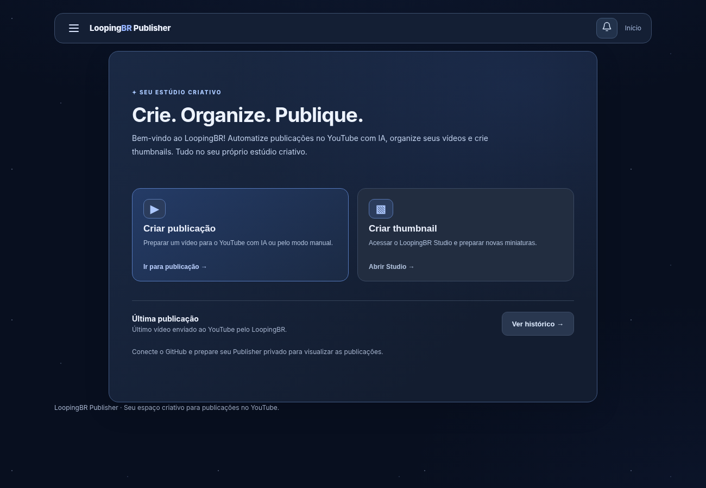
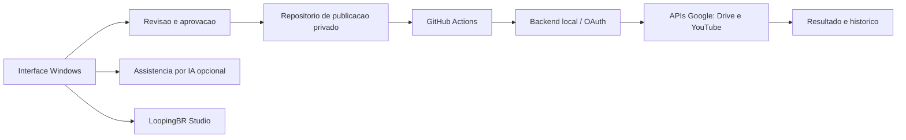
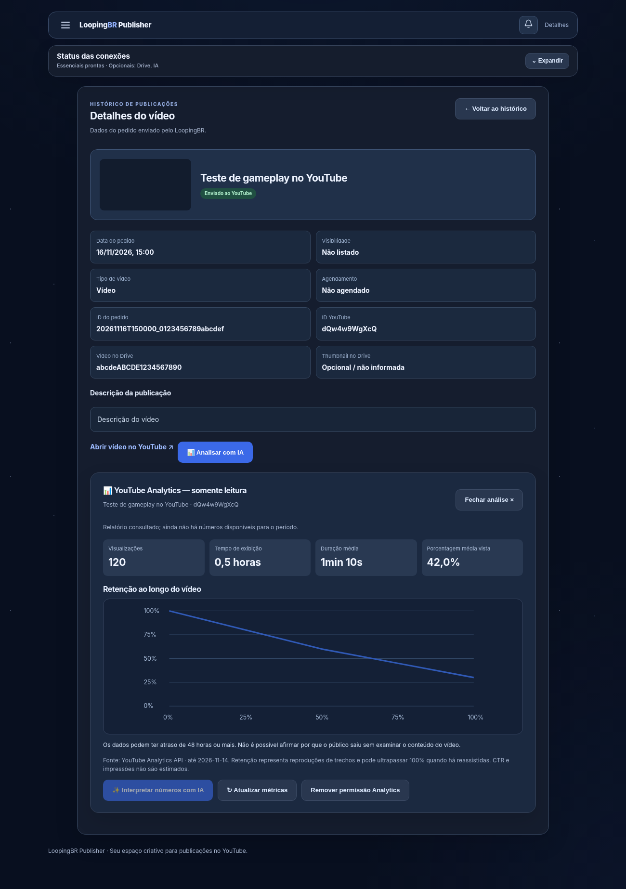

# LoopingBR Publisher

**Um painel para preparar, organizar e publicar vídeos no YouTube, integrando automação, serviços externos e recursos de IA.**

Projeto pessoal desenvolvido para reduzir etapas repetitivas na rotina de um canal: reunir arquivos, conferir dados, preparar uma publicação e acompanhar seu resultado. A aplicação combina uma interface local para Windows, um backend de autenticação e um fluxo de execução no GitHub Actions.

> **Estado do projeto:** versão de laboratório **v1.0.14.1**. O código-fonte está disponível para estudo e compilação; para utilizar as integrações reais, cada pessoa deve configurar as próprias contas. Esta edição de portfólio não contém tokens, perfis do autor nem pedidos reais de publicação.



## O que o projeto faz

- Organiza o fluxo de publicação com etapas de configuração, escolha de arquivos, revisão e confirmação.
- Trabalha com vídeos comuns e Shorts, títulos, descrições, visibilidade, miniaturas e agendamento.
- Integra GitHub e GitHub Actions para processar pedidos de publicação aprovados.
- Permite usar arquivos locais ou Google Drive conforme a configuração da conta.
- Consulta o histórico dos pedidos e, quando há autorização, dados disponíveis no YouTube Analytics.
- Oferece assistência de IA para rascunhos e interpretação conservadora de dados, sem publicar automaticamente por uma sugestão da IA.
- Disponibiliza o **LoopingBR Studio**, um fluxo separado de apoio à criação de thumbnails.

## Visão geral do funcionamento



A publicação exige uma ação de confirmação do usuário. O código diferencia a criação de um pedido do resultado efetivo do upload: falhas e resultados incertos precisam de conferência no YouTube Studio antes de qualquer nova tentativa.

## Tecnologias utilizadas

| Camada | Tecnologias |
| --- | --- |
| Aplicativo local | Go 1.23 e interface HTML/CSS/JavaScript |
| Backend local | Go, HTTP e OAuth 2.0 |
| Automação | GitHub, GitHub Actions e Python |
| Integrações | YouTube Data API, Google Drive API, YouTube Analytics API e ChatGPT (opcional) |
| Segurança | Armazenamento protegido pelo Windows, OAuth, validação de requisições e conferência de identidade do repositório no fluxo |

## Comece por aqui

1. Leia o [guia de instalação e configuração](docs/INSTALACAO.md).
2. Confira a [arquitetura e os componentes](docs/ARQUITETURA.md).
3. Consulte [testes e limitações](docs/TESTES-E-LIMITACOES.md) antes de testar com contas reais.
4. Para compilar, abra `apps/publisher-hibrido` e execute `go test ./...` e `GERAR-EXES-LAB.bat` no Windows com Go instalado.

Os executáveis Windows são gerados separadamente do repositório de código. Isso mantém o histórico do GitHub legível e facilita a análise do funcionamento. Os scripts de compilação originais estão preservados.

## Estrutura do repositório

```text
apps/publisher-hibrido/        Aplicativo, backend, testes e recursos embarcados
integracoes/loopingbr-studio-plugin/  Fonte do plugin Studio v1.8.0
integracoes/publicador-classico/     Snapshot historico do fluxo Python/GitHub
ferramentas/                  Importacao segura de codigo do GitHub original
exemplos/                     Dados ficticios para entender o formato dos pedidos
docs/                         Instalacao, arquitetura, seguranca e testes
.github/workflows/ci.yml      Verificacao automatica sem acesso a contas
```

Para atualizar o módulo clássico a partir do repositório privado, consulte [Sincronização do GitHub operacional](docs/GITHUB-OPERACIONAL.md).

**Importante sobre as duas implementações:** o aplicativo híbrido em Go é a base atual desta edição. O `publicador-classico` foi mantido como referência de evolução do projeto e provém de um pacote de exportação anterior; ele **não é um espelho completo da versão atual do repositório operacional privado**.

## Demonstração



*Captura ilustrativa do painel de análise; os identificadores e números exibidos na imagem são demonstrativos. Uma gravação com a aplicação real poderá ser adicionada aqui.*

## Como foi desenvolvido

O projeto surgiu de uma necessidade própria de publicação de vídeos. Seu desenvolvimento envolveu planejamento do fluxo, experimentos de interface, configuração de integrações, testes de uso e revisões após falhas encontradas. Ferramentas de IA generativa foram usadas como apoio à prototipação, implementação e documentação; as decisões de produto e a validação prática fizeram parte do processo.

**Responsável pelo projeto:** Kauan Fernandes. Outros créditos presentes no software original foram preservados.

## Próximos passos

O projeto continua em evolução. As prioridades incluem melhorar a instalação inicial, ampliar os testes automatizados de integração, consolidar a documentação e registrar uma demonstração do fluxo completo.

Este repositório é uma **apresentação técnica**, não um serviço público de hospedagem ou uma promessa de operação contínua. Serviços de terceiros exigem autorização própria e podem impor cotas, restrições de privacidade ou mudanças de API.
