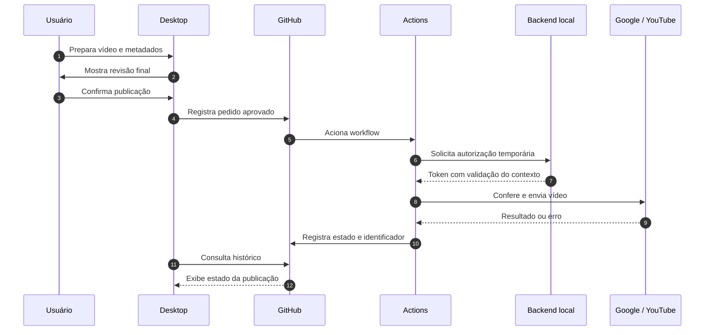

# Arquitetura do LoopingBR

## Componentes

| Componente | Responsabilidade | Código |
| --- | --- | --- |
| Desktop | Interface, edição, revisão de pedidos e coordenação de contas | `apps/publisher-hibrido/main.go`, `index.html` |
| Backend local | OAuth Google, associação de contas, proteção de credenciais, endpoints de apoio e dados | `apps/publisher-hibrido/backend/` |
| Executor de publicação | Validação de pedidos, download, upload de vídeo e resultado | `apps/publisher-hibrido/assets/publisher.py` |
| GitHub Actions | Processa novos pedidos aprovados no repositório operacional | `apps/publisher-hibrido/assets/workflow.yml` |
| Studio | Fluxo de criação de thumbnails por IA, separado do envio de vídeos | `integracoes/loopingbr-studio-plugin/` |
| Publicador clássico | Etapa anterior da evolução do projeto, com autenticação própria no GitHub | `integracoes/publicador-classico/` |

## Fluxo de uma publicação

## Separação de responsabilidades

O Desktop mantém a experiência do usuário e o fluxo de aprovação. O backend funciona como intermediário local para autenticação Google. O workflow remoto executa operações de upload e registra resultados. A ferramenta Studio é independente: cria o fluxo de preparação visual, mas não é o responsável pelo upload em si.

## Decisões de projeto

- **Confirmação humana:** IA não autoriza uma publicação sozinha.
- **Credenciais fora do Git:** a autenticação ocorre no computador/conta de cada usuário, com proteção local e segredos configurados fora do código.
- **Rastreabilidade:** pedidos e resultados ficam separados para permitir auditoria do que foi iniciado e concluído.
- **Proteção contra repetição:** o processamento reserva uma execução antes do envio e exige autorização explícita para republicações intencionais.
- **Limitação assumida:** testes unitários não substituem validação de OAuth, rede, quotas e comportamento do YouTube em cada ambiente.
